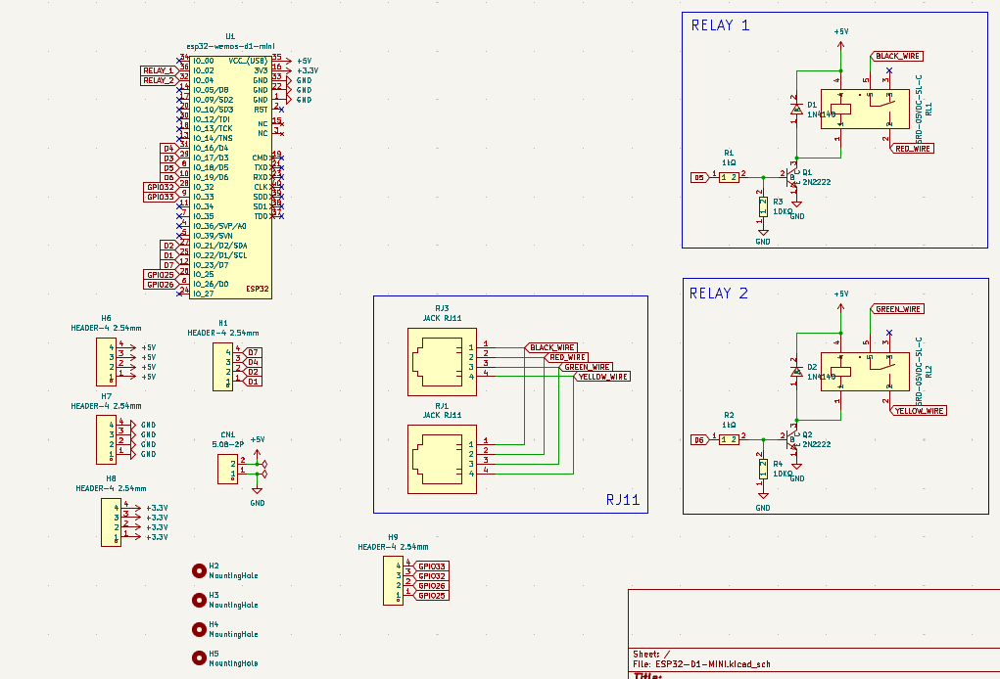
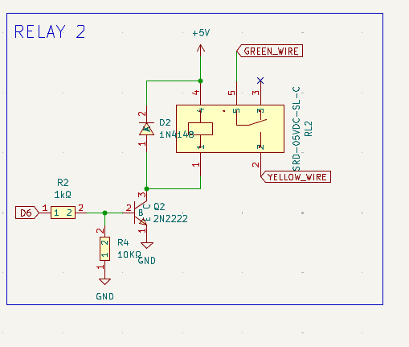
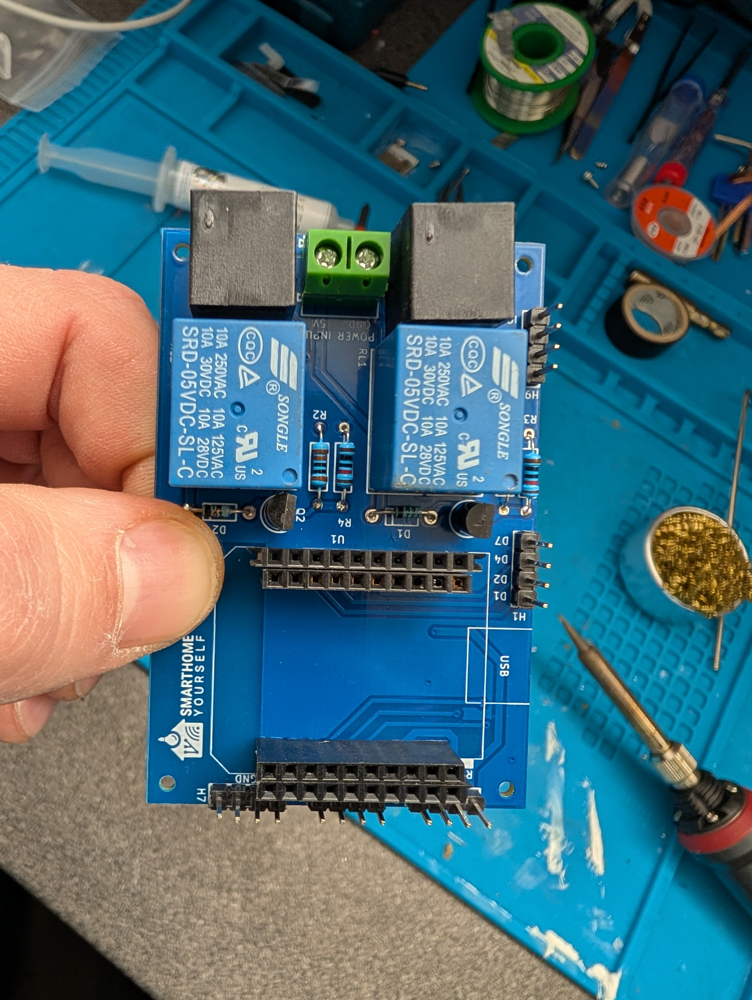
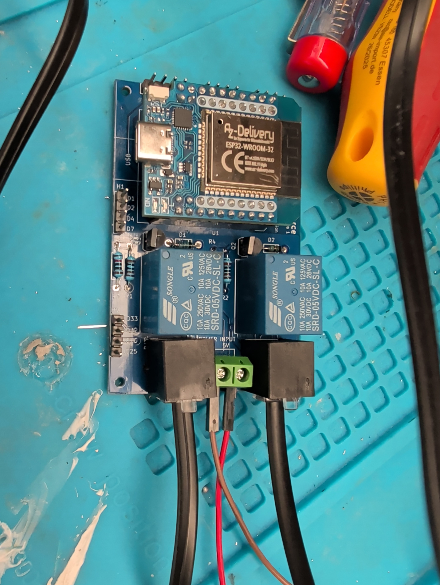
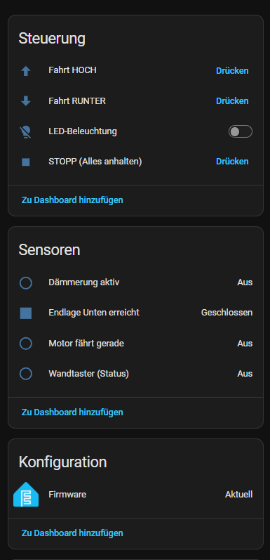
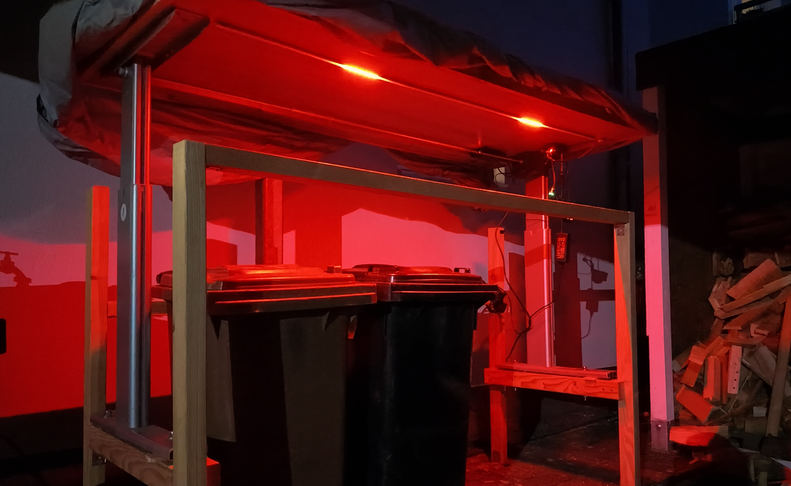

# Actiforce Schreibtisch – ESPHome Motorsteuerung

Smarte Steuerung eines motorisierten Actiforce Stehschreibtisches via ESP32 D1 Mini, 2 Relais und WS2812B LED-Streifen — vollständig in Home Assistant integriert, ohne den Original-Controller zu ersetzen.

Der Actiforce-Controller bleibt vollständig erhalten. Der ESP32 simuliert lediglich einen Tastendruck über zwei Relais, die parallel zur Original-Fernbedienung geschaltet werden (RJ11-Zwischenstecker). Der Tisch ist weiterhin über die Original-Bedienung steuerbar.

---

## ✅ Funktionen

- Steuerung per **Home Assistant**, App, Alexa/Google oder Sprachassistent
- Automatische Fahrt nach oben und unten per Knopfdruck oder Automatisierung
- **Reed-Kontakt** erkennt die untere Endposition zuverlässig (kein Überfahren)
- Zeitbasierte Steuerung für die Aufwärtsfahrt (konfigurierbar)
- **LED-Lauflicht** während der Fahrt (rot = fährt, grün = oben angekommen, warmweiß = Wartezeit)
- LED nur bei Dämmerung/Nacht aktiv – automatisch per Sonnenstandsberechnung
- **Auto-Close:** Tisch fährt nach einstellbarer Zeit automatisch wieder runter
- Physischer Taster: Toggle HOCH/RUNTER + Stopp während der Fahrt
- **Ohne WLAN** vollständig per Taster bedienbar (Offline-Fallback)
- Interlock verhindert gleichzeitiges UP + DOWN (Schutz vor Kurzschluss)
- Software-Timeout als zusätzliche Absicherung

---

## 🎬 Video

▶️ [YouTube: Actiforce Schreibtisch mit ESP32 & ESPHome automatisieren](https://youtu.be/tbvZwFibh_8)

---

## 🔧 Hardware

| Komponente | Details |
|---|---|
| **Schreibtisch** | Actiforce (motorisiert, Original-Controller bleibt erhalten) |
| **Mikrocontroller** | ESP32 D1 Mini (Wemos/AZ-Delivery, ESP32-WROOM-32) |
| **Relais 1 & 2** | Songle SRD-05VDC-SL-C (LOW-aktiv, 2-Kanal-Board) |
| **Transistoren Q1/Q2** | 2N2222 (NPN, TO-92) |
| **Freilaufdioden D1/D2** | 1N4148 |
| **Widerstände** | 2× 1 kΩ (Basis), 2× 10 kΩ (Pull-down) |
| **LED-Streifen** | WS2812B, 94 LEDs, 5 V |
| **Endlagensensor** | Reed-Kontakt (NC, für untere Position) |
| **Taster** | Drucktaster (gegen GND) |
| **Schutzwiderstand** | 330 Ω (Datenleitungsschutz LED) |
| **Verbindung** | RJ11-Zwischenstecker (parallel zu Original-Tasten) |
| **Stromversorgung** | 5 V Netzteil für ESP32 + LEDs |

### 🛒 Einkaufsliste

- Actiforce Schreibtischgestell: https://www.schaefer-shop.de/p/hoehenverstellbare-schreibtischgestelle
- AZ-Delivery ESP32 D1 Mini: https://link.amazon/B0iHIORRt *
- WS2812B LED-Streifen (5V): https://link.amazon/B0cPbTL7f *
- 2-Kanal Relais-Modul: https://link.amazon/B079fXzYc *
- Reed-Kontakt: https://link.amazon/B04lU5jjy *
- RGB-Taster: https://link.amazon/B04FjZAeY *
- Netzteil 5V: https://link.amazon/B062MLP1g *
- Schutzwiderstand: https://link.amazon/B05Um5BQp *
- RJ11 PCB Connector: https://link.amazon/B02N98Co2 *
- Transistor-Set: https://link.amazon/B02ZBn9kA *
- Diode: https://link.amazon/B0bAp7Kfd *

<sub>Mit Stern gekennzeichnete Links sind Affiliate-Links. Für dich bleibt der Preis gleich, aber ich erhalte eine kleine Provision. Vielen Dank für deine Unterstützung!</sub>

### GPIO-Belegung (ESP32 D1 Mini)

| GPIO | Pin | Funktion |
|---|---|---|
| GPIO19 | D6 | Relais UP (Hochfahren) |
| GPIO18 | D5 | Relais DOWN (Runterfahren) |
| GPIO23 | D7 | Physischer Taster (gegen GND) |
| GPIO16 | D4 | WS2812B Datenleitung |
| GPIO33 | – | Reed-Kontakt (untere Endlage, gegen GND) |

---

## 📐 Schaltplan

Kompletter Schaltplan (ESP32 D1 Mini, beide Relais, RJ11-Buchsen, Pin-Header):



Detailansicht eines Relais-Kanals (identisch für Relais 1 & 2):



---

## 🖨️ 3D-Druck – Gehäuse

Ein passendes Gehäuse für die Platine liegt als druckfertige STL-Datei bei:

- [`hardware/actiforce_gehaeuse.stl`](hardware/actiforce_gehaeuse.stl)

Empfohlene Druckeinstellungen: PLA oder PETG, 0,2 mm Schichthöhe, 15–20 % Infill.

---

## 📸 Fotos

**SmartHome-yourself Platine (bestückt):**



**Verkabelter Aufbau (ESP32, Relais, WS2812B, Taster, Reed-Kontakt):**


**ESP32 D1 Mini auf dem Relais-Board (Detail):**



**Home Assistant Dashboard:**



**Fertige Installation bei Nacht (Mülltonnenbox mit LED-Beleuchtung):**



---

## 💻 Firmware

### Installation

1. [ESPHome](https://esphome.io) installieren
2. `firmware/schreibtisch.yaml` herunterladen
3. **Substitutions** oben in der YAML-Datei anpassen:

### Wichtige Einstellungen (Substitutions)

| Variable | Beschreibung | Standard |
|---|---|---|
| `laufzeit_hoch` | Fahrzeit für komplette Aufwärtsfahrt | `19s` |
| `laufzeit_runter` | Backup-Fahrzeit abwärts (falls Reed ausfällt) | `16s` |
| `auto_close_zeit` | Wartezeit bis Auto-Close | `5min` |
| `num_leds` | Anzahl LEDs im Streifen | `94` |
| `anim_breite` | Breite des Lauflicht-Blocks in LEDs | `6` |
| `anim_delay` | Geschwindigkeit Lauflicht in ms | `30` |
| `latitude` / `longitude` | Standort für Dämmerungserkennung | – |

### WiFi / Secrets

Alle persönlichen Zugangs- und Netzwerkdaten werden über ESPHome Secrets ausgelagert – in der YAML stehen nur Platzhalter.
→ [ESPHome Secrets Guide](https://esphome.io/guides/secrets.html)

Kopiere `firmware/secrets.yaml.example` nach `secrets.yaml` und trage deine Werte ein:

```yaml
# secrets.yaml
wifi_ssid: "MeinNetzwerk"
wifi_password: "MeinPasswort"
ap_password: "EinSicheresAPPasswort"
static_ip: "192.168.178.50"   # optional (nur bei fester IP)
gateway: "192.168.178.1"      # optional (nur bei fester IP)
```

> ⚠️ **Hinweis:** `secrets.yaml` niemals ins Git-Repository committen! In der Firmware-YAML sind IP, Gateway
> und die GPS-Koordinaten (`latitude` / `longitude`) bewusst geschwärzt – bitte vor dem Flashen eigene Werte eintragen.

---

## ⚠️ Wichtige Hinweise

- **Interlock nicht entfernen!** Verhindert gleichzeitiges UP+DOWN — Motorschutz.
- Die **Aufwärtsfahrt** ist rein zeitbasiert (kein oberer Reed-Kontakt). Laufzeit genau messen.
- Die **Abwärtsfahrt** stoppt primär über den Reed-Kontakt, Zeitwert ist nur Backup.
- LED-Animation ist **nur bei Dämmerung** aktiv (per Sonnenstandsberechnung — Standort in Substitutions eintragen).
- Der **Dämmerungs-Test-Override** in Home Assistant ermöglicht Testen ohne auf den Abend warten zu müssen.
- Relais sind **LOW-aktiv** — beim ESP32-Start werden sie explizit deaktiviert.

---

## 🌐 Links

- [SmartHome-yourself Website](https://www.smarthomeyourself.de)
- [SmartHome-yourself Discord](https://smarthomeyourself.de/discord)
- [ESPHome Dokumentation](https://esphome.io)
- [Home Assistant](https://www.home-assistant.io)
- [Garagensteuerung von Daniel (LED-Animation Referenz)](https://youtu.be/NvoPeyG30WA)

---

## 💡 Inspiration & Credits

Dieses Projekt basiert auf der Idee von **Frickelzeug** und seinem Projekt **TrashStation**: eine Mülltonnen-Einhausung auf Basis eines elektrisch höhenverstellbaren Schreibtischgestells, gesteuert per ESP32.

👉 [frickelzeugs/TrashStation auf GitHub](https://github.com/frickelzeugs/TrashStation)

Vielen Dank an Frickelzeug für das Teilen des Projekts! Diese Umsetzung ist eine eigenständige Neuentwicklung mit ESPHome, eigener Platine und paralleler Ansteuerung der Actiforce-Originalsteuerung.

---

## 📄 Lizenz

MIT License — frei verwendbar, anpassbar und weitergabe erlaubt.
Bitte bei Veröffentlichungen auf das Original-Projekt verweisen.
